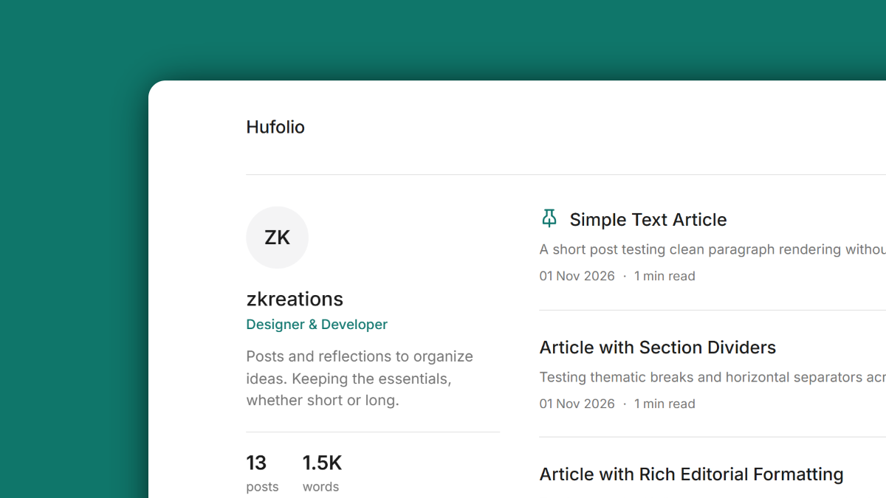

<p align="center">
  
  <h1 align="center">Hufolio</h1>
</p>

<p align="center">A minimalist and lightweight Hugo theme for writers and portfolios. No dependencies, no JavaScript, and compatible with the standard Hugo binary.</p>

<p align="center">
  <a href="https://github.com/zkreations/hufolio/blob/main/LICENSE"></a>
  <a href="https://github.com/zkreations/hufolio/releases"></a>
  <a href="https://github.com/zkreations/hufolio/actions/workflows/ci.yml"></a>
  <a href="https://app.netlify.com/projects/hufolio-demo/deploys"></a>
</p>

<p align="center">
  <a href="https://hufolio.zkreations.com/"><strong>View a live demo →</strong></a>
</p>



## Features

- **Zero dependencies:** No Node.js, npm, Sass, or PostCSS required.
- **No JavaScript:** Pages are plain HTML and CSS.
- **Minimal design:** Focused on readable typography and content.
- **Telegram Instant View Native:** Design-agnostic HTML contract (`data-iv`) and ready-to-deploy Instant View 2.1 template.
- **Automatic dark mode:** Uses `@media (prefers-color-scheme: dark)`.
- **Accessibility:** Semantic HTML5 landmarks, skip link, visible focus ring, and color contrast that meets WCAG AA ratios.
- **Hugo Standard:** Works with the standard Hugo binary (extended edition not required).
- **SEO & AI-ready:** Open Graph, Twitter Cards, canonical URLs, RSS autodiscovery, production-aware `robots.txt`, and structured `llms.txt` / `llms-full.txt` support.
- **Local typography:** High-legibility Inter font bundled as local WOFF2 with zero external font requests.
- **Multilingual (i18n):** Native internationalization support with built-in English and Spanish translations.

## Requirements

- Hugo 0.164.0 or higher
- [Git](https://git-scm.com/downloads)

## Installation

### Option 1: As a Git submodule (Recommended)

From the root of your Hugo project:

```bash
git submodule add https://github.com/zkreations/hufolio.git themes/hufolio
```

Then add `theme = "hufolio"` to your `hugo.toml`.

### Option 2: Direct clone

```bash
git clone https://github.com/zkreations/hufolio.git themes/hufolio
```

## Quick Start

The quickest way to get started is by copying the sample configuration from `exampleSite`:

```bash
cp themes/hufolio/exampleSite/hugo.toml ./hugo.toml
```

To run the bundled demonstration site locally from the theme directory:

```bash
hugo server --source exampleSite --themesDir ../..
```

## Configuration Reference

Example `hugo.toml`:

```toml
baseURL = 'https://example.com/'
title = 'My Portfolio'
theme = 'hufolio'
defaultContentLanguage = 'en'
enableRobotsTXT = true
enableGitInfo = true
disableKinds = ['taxonomy', 'term']

[outputFormats.llms]
  baseName = 'llms'
  mediaType = 'text/plain'
  isPlainText = true
  notAlternative = true

[outputFormats.llmsfull]
  baseName = 'llms-full'
  mediaType = 'text/plain'
  isPlainText = true
  notAlternative = true

[outputs]
  home = ['html', 'rss', 'llms', 'llmsfull']

[menus]
  [[menus.main]]
    name = 'About'
    pageRef = '/about'
    weight = 1

[params]
  description = 'A minimalist portfolio and journal for writers and developers.'
  author = 'Author Name'
  author_role = 'Designer & Developer'
  author_bio = 'Posts and reflections to organize ideas. Keeping the essentials, whether short or long.'
  date_format = '02 Jan 2006'
  home_posts_limit = 5
  show_reading_time = true
  footer_text = 'All rights reserved.'
  cover_wide = true
  telegram_channel = '@mychannel'

  [[params.social]]
    name = 'GitHub'
    url = 'https://github.com/zkreations'
```

### Supported Parameters (`[params]`)

| Parameter | Type | Default | Description |
|---|---|---|---|
| `description` | string | `""` | Site description used for meta tags and homepage fallback. |
| `author` | string / map | `""` | Author name (`author = "Name"`) or structured map (`name`, `role`, `bio`). |
| `author_role` | string | `""` | Author role or tagline displayed in the homepage profile. |
| `author_bio` | string | `""` | Short biography displayed on the homepage profile. |
| `date_format` | string | `"02 Jan 2006"` | Date display format (Go time format string). |
| `home_posts_limit` | int | `5` | Maximum number of posts listed on the homepage before pagination. |
| `list_posts_limit` | int | `nil` | Optional maximum posts displayed per page on section/archive list views. |
| `show_reading_time` | bool | `true` | Display estimated reading time on articles. |
| `cover_wide` | bool | `false` | Expand article cover images beyond the text column width. |
| `mainSections` | []string | `["posts"]` | Content sections treated as editorial articles. |
| `telegram_channel` | string | `""` | Telegram channel username (e.g., `@mychannel`) for Instant View join button. |
| `footer_text` | string | `""` | Optional text displayed alongside the copyright in the footer. |
| `social` | []map | `[]` | List of social links with `name` and `url` displayed in the footer. |

### Post Front Matter

Posts support the following front matter variables:

```markdown
---
title: "Article Title"
description: "Brief summary used for previews and SEO meta description."
date: 2026-11-08T12:00:00Z # Optional, falls back to Git commit date (with enableGitInfo) or "Undated"
author: "Author Name" # Optional, falls back to params.author
image: "cover.jpg" # Optional explicit cover image
image_alt: "Alternative text for the cover image"
cover_wide: true # Optional per-post wide cover override
kicker: "Editorial" # Optional kicker / category above the title
pinned: true # Optional, pins the post to the top of the homepage feed
draft: false
---
```

#### Cover Image Resolution Cascade

When rendering featured covers, Hufolio resolves images in the following priority:
1. Explicit `image` field in front matter (`.Params.image`).
2. A bundle resource named `cover.*` (e.g. `cover.jpg`, `cover.webp`).
3. A bundle resource named `featured.*` (e.g. `featured.jpg`, `featured.png`).
4. The first image found within the Page Bundle.

When resolved, images are automatically resized and converted to modern WebP with explicit dimensions, `loading="eager"`, and `decoding="async"` for optimal LCP performance.

### Standalone Pages

To create standalone pages (such as `/about/` or `/privacy/`):

```bash
hugo new about.md
```

Hufolio renders standalone pages with `<article class="page">` without `data-iv="article"`. This ensures visual consistency while preventing Telegram Instant View from triggering on non-editorial landing pages.

### Telegram Instant View

Hufolio includes native support for **Telegram Instant View 2.1** through a **Design-Agnostic Contract** (`data-iv`). This decouples Instant View compatibility from styling classes, guaranteeing that visual redesigns or custom CSS never break Instant View rendering.

#### Setup

1. Deploy your site to your domain (e.g., `https://example.com`).
2. Open the [Telegram Instant View Checklist](https://instantview.telegram.org/my/) with your Telegram account.
3. Enter the URL of any article on your site into the **Target Pages** field.
4. Paste the official template rules below into the code editor:

```text
~version: "2.1"

# Match single article pages via Design-Agnostic Contract
?exists: //article[@data-iv="article"]

$article: //article[@data-iv="article"]

# Extract header metadata with Open Graph fallbacks
title:          $article//*[@data-iv="title"]
title:          //meta[@property="og:title"]/@content

subtitle:       $article//*[@data-iv="description"]
subtitle:       //meta[@property="og:description"]/@content

kicker:         $article//*[@data-iv="kicker"]

author:         $article//*[@data-iv="author"]
author:         //meta[@property="article:author"]/@content

published_date: $article//*[@data-iv="date"]/@datetime
published_date: //meta[@property="article:published_time"]/@content

cover:          ($article//*[@data-iv="cover"]//img)[1]

# Site branding and optional native Telegram channel subscribe button
site_name:      //meta[@property="og:site_name"]/@content
channel:        //meta[@name="telegram:channel"]/@content

# Main article content container
$body:          $article//*[@data-iv="body"]

# Agnostic element removals
@remove:        $body//*[@data-iv="ignore"]

body:           $body
```

5. Review the mobile preview and click **Mark as checked** across 10 articles to unlock Instant View for your entire domain.

#### Contract Reference (`data-iv`)

| Attribute | Scope | Purpose |
|---|---|---|
| `data-iv="article"` | Root `<article>` | Identifies single editorial articles. Absent on static landing pages. |
| `data-iv="title"` | `<h1>` | Article headline. Falls back to `og:title`. |
| `data-iv="description"` | `<p>` | Subtitle or summary. Falls back to `og:description`. |
| `data-iv="kicker"` | `<span>` | Optional kicker or category above headline. |
| `data-iv="author"` | `<span>` | Post author name. Falls back to `article:author`. |
| `data-iv="date"` | `<time>` | ISO 8601 publication date from `datetime` attribute. Falls back to `article:published_time`. |
| `data-iv="cover"` | `<figure>` | Featured post cover image container. |
| `data-iv="body"` | `<div>` | Dedicated container for editorial Markdown content. |
| `data-iv="ignore"` | Any tag | Elements to remove from Instant View (e.g., heading anchor links). |

### Search Engines & LLMs

#### robots.txt

Enable standard `robots.txt` generation in your `hugo.toml`:

```toml
enableRobotsTXT = true
```

The theme conditions crawler access automatically:
- **Production (`hugo.IsProduction`):** Allows all crawlers and links to `sitemap.xml`.
- **Development / Previews:** Blocks all crawlers (`Disallow: /`) to prevent indexing test or staging builds.

#### llms.txt & llms-full.txt

Hufolio includes native support for the [llmstxt.org](https://llmstxt.org) standard for AI models and assistants. Configure the output formats and enable them under `[outputs]` in your `hugo.toml`:

```toml
[outputFormats.llms]
  baseName = 'llms'
  mediaType = 'text/plain'
  isPlainText = true
  notAlternative = true

[outputFormats.llmsfull]
  baseName = 'llms-full'
  mediaType = 'text/plain'
  isPlainText = true
  notAlternative = true

[outputs]
  home = ['html', 'rss', 'llms', 'llmsfull']
```

- **`/llms.txt`**: A concise Markdown index of your posts and pages with summaries and links to supplementary resources.
- **`/llms-full.txt`**: A complete consolidated Markdown document with full page content (`.RawContent`) for context-window feeding.

## Customization

### Custom CSS & Tokens

All visual properties are defined as semantic CSS custom properties in `:root`. You can customize tokens by overriding `assets/css/_tokens.css` in your site root without modifying theme files. Because Hugo replaces the entire file, copy the theme's `_tokens.css` as a baseline to preserve the `@font-face` definitions:

```css
:root {
  --content-max-width: 720px;
  --surface: #ffffff;
  --on-surface: #111827;
}

@media (prefers-color-scheme: dark) {
  :root {
    --surface: #030712;
    --on-surface: #f9fafb;
  }
}
```

### Overriding Templates

To override any template or partial, create a file with the same relative path inside your site's `layouts/` directory. For example, to customize the footer, create `layouts/partials/footer.html`.

## License

This project is licensed under the [MIT](LICENSE) License. Created by [zkreations](https://www.zkreations.com).
