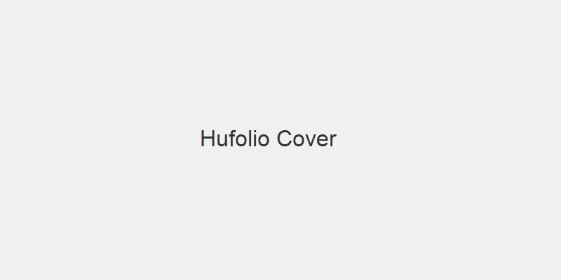

This post showcases Hufolio's seamless support for local assets through Hugo Page Bundles.

The cover image is presented in the article header and serves as the visual reference for Telegram Instant View.

## Inline Media

Here is an inline image rendered from the local page bundle:

Notice how it automatically resolves dimensions and includes a semantic caption.
